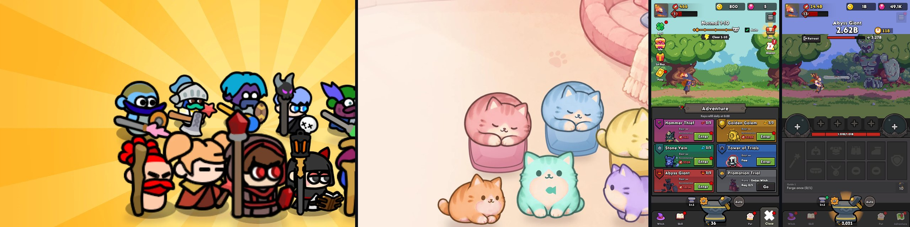
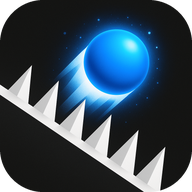
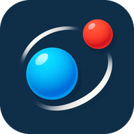
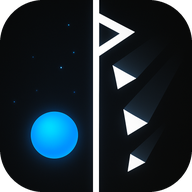
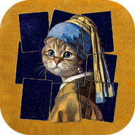
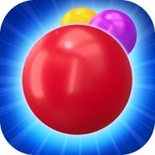
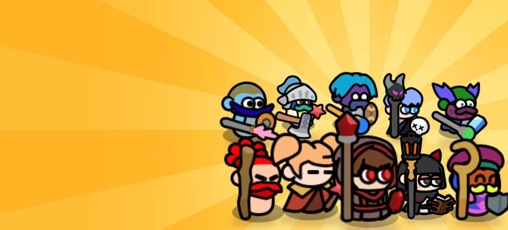
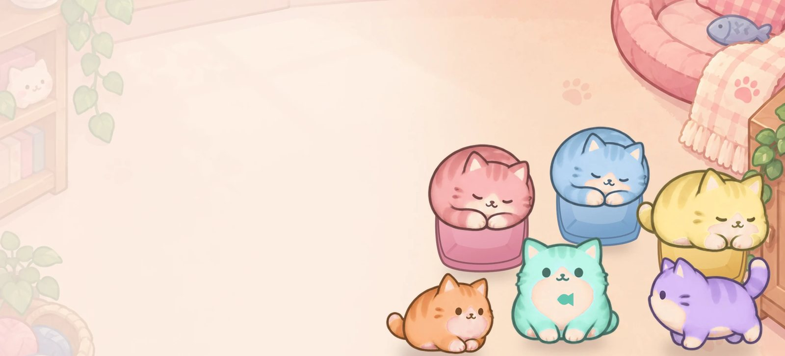
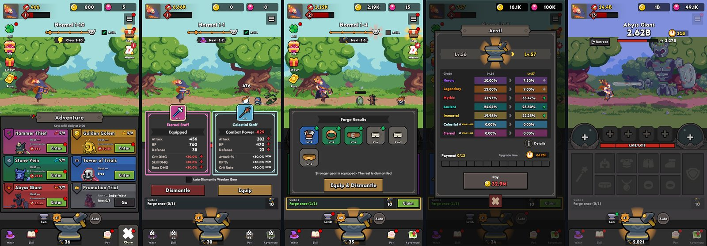
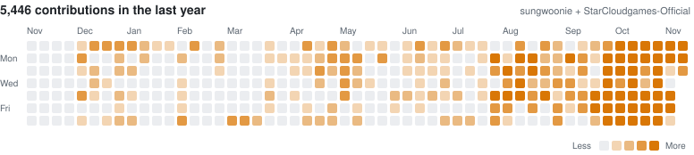

### 양성운 · Unity 클라이언트 프로그래머

모바일 게임 **11종**을 출시했습니다. 회사에서 5종, 1인 스튜디오 [StarCloudGames](https://starcloudgames.com)에서 6종을 기획부터 출시까지 만들었습니다. 
빌드부터 스토어 등록까지는 Jenkins 로 넘기고, AI 와 일하는 개발 도구를 직접 만들어 씁니다.

[포트폴리오](https://sungwoonie.github.io/Portfolio_Page/) · [StarCloudGames](https://starcloudgames.com) · [스튜디오 계정 @StarCloudgames-Official](https://github.com/StarCloudgames-Official) · sung_woonie@naver.com

 

#### 출시한 게임

StarCloudGames · 1인 개발 
&nbsp;
&nbsp;
&nbsp;
&nbsp;
&nbsp;

회사 프로젝트 
&nbsp;
&nbsp;
&nbsp;
&nbsp;

 

#### 대표 프로젝트

**활활법사**

> 서바이버 액션 RPG · 1인 개발 · Unity 6 · 2026.03 ~ 2026.10

몰려오는 적을 불꽃 마법으로 쓸어 내는 게임. 클라우드 세이브, Apple·Google 로그인, 가챠 확률 공개까지 라이브 서비스에 필요한 것을 혼자 갖췄습니다. 몬스터 이동·분리·길찾기·충돌 검사는 Burst 잡과 Spatial Hashing 으로 옮겨 프레임 드랍을 없앴습니다.

`Job System` · `Spatial Hashing` · `Firebase Auth · RTDB` · `에디터 자동 플레이 회귀 테스트` · `Jenkins 스토어 배포`

[Google Play](https://play.google.com/store/apps/details?id=com.starcloudgames.scg003) · [포트폴리오](https://sungwoonie.github.io/Portfolio_Page/)

 

**Meow Flow!**

> 길 잇기 퍼즐 · 1인 개발 · Unity 6 · 2026.10

같은 색 고양이와 쿠션을 담요 길로 잇는 퍼즐. 해답이 정확히 하나인 판만 수록하는 생성기로 1,000판을 만들고 약 2주 만에 출시했습니다.

`퍼즐 생성기 (Python)` · `해답 유일성 검증` · `LevelPlay` · `Unity IAP`

[Google Play](https://play.google.com/store/apps/details?id=com.starcloudgames.scg005)

 

**엘레오노르** 개발 중

> 세로형 픽셀 방치 RPG · 1인 개발 · Unity 6 · 2026.10 ~

망치로 장비를 단조해 끼고 분해하며 사냥하는 방치형 RPG. 개발 에이전트와 검사 에이전트를 나눈 AI 개발 루프로 화면 72개를 구현했고, 기능 550개를 플레이 증거로 다시 감사했습니다.

`AI 개발 루프` · `개발 · 검사 레인 분리` · `플레이 캡처 검증`

 

#### 직접 만든 도구

- **SCG Dev** 폰의 슬랙만으로 기획, 리소스, 개발을 끝까지 미는 게임 제작 앱. Electron · TypeScript
- **SCG Sheets** 유니티와 AI 가 토큰 없이 구글 시트를 다루게 하는 로컬 REST API 앱
- **SCG Sound** 원하는 소리를 말하면 이 맥에서 효과음을 생성하는 앱. Stable Audio 3 · MLX
- **SCG Dashboard** 출시한 게임의 GA4 지표를 매일 모아 보여주는 대시보드. Cloudflare Workers
- **SCG PM** 여러 레포의 할 일을 칸반으로 AI 에게 나눠 맡기는 앱
- **CLOUDIE** 어제 한 일을 정리하고 오늘 할 일을 골라 주는 데스크톱 구름
- **AI-SKILLS** 결정은 먼저 잠그고 완료는 증거로 판정하는 Claude Code · Codex 스킬 14개

Jenkins 잡 5개로 `Android 빌드` · `iOS 빌드` · `인앱 상품 등록` · `스토어 등록정보` · `GA4 파라미터 등록`을 배포합니다. 전부 비공개 저장소라 실제 화면은 [포트폴리오](https://sungwoonie.github.io/Portfolio_Page/)에 있습니다.

 

#### 기술

`Unity 6` `C#` `URP` `Job System` `UniTask` `R3` `LitMotion` `Addressables` `Firebase` `LevelPlay` `Unity IAP` `Jenkins` `GitHub Actions` `Python` `TypeScript` `Electron`

 

#### 활동

<picture>
  <source media="(prefers-color-scheme: dark)" srcset="assets/contributions-dark.svg">
  
</picture>

회사·개인 게임 커밋은 스튜디오 계정 [@StarCloudgames-Official](https://github.com/StarCloudgames-Official)에 쌓여서, 두 계정을 합쳐 매일 다시 그립니다.
